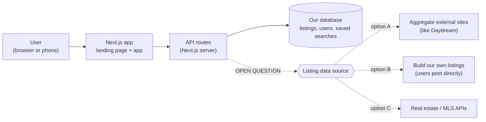

# System overview

First sketch, made before any code exists. Update it as decisions are made.

## What's decided
- One Next.js app serves both the landing pages and the product.
- Waitlist signups (email, what they're looking for, page, UTMs) go to a
  Supabase `signups` table through a server action (`src/app/actions.ts`).
- Search (demo): the homepage chat box sends people to `/search?q=...`. It
  shows hand-written sample listings from `src/content/listings.ts`; no real
  listing source is connected yet.
- Accounts: Supabase Auth (email + password). Each user's hearted listings
  are rows in a Supabase `favorites` table, shown on `/favorites` with a map.

## What's still open
- **Where listing data comes from.** MLS access is the main blocker. Scraping
  needs a legal check before anyone builds it. A few real estate APIs were
  found and still need assessing. The team planned to decide this at the
  Thursday sync.
- Hosting (Railway or Vercel). Supabase is the database for signups; confirm
  it for listings with the first listings feature.
