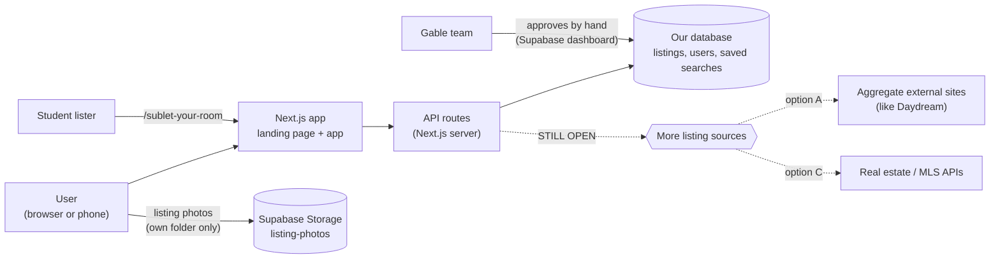

# System overview

First sketch, made before any code exists. Update it as decisions are made.

## What's decided
- One Next.js app serves both the landing pages and the product.
- Waitlist signups (email, what they're looking for, page, UTMs) go to a
  Supabase `signups` table through a server action (`src/app/actions.ts`).
- Search (demo): the homepage chat box sends people to `/search?q=...`. It
  searches the hand-written sample listings in `src/content/listings.ts` plus
  approved real listings.
- Real listings (option B, decided Nov 5, 2026): students post sublets on
  `/sublet-your-room` (demo site). They go to a Supabase `student_listings`
  table as `pending`, with photos in the `listing-photos` Storage bucket. The
  team checks each one by hand and approves it in the dashboard; only then does
  it show in search, labeled "Real listing", at `/sublet/[id]`.
- Accounts: Supabase Auth (email + password). Each user's hearted listings
  are rows in a Supabase `favorites` table, shown on `/favorites` with a map.

## What's still open
- **Other listing sources.** Student posts are the first real source. MLS
  access is the main blocker for more. Scraping needs a legal check before
  anyone builds it. A few real estate APIs were found and still need assessing.
- Hosting (Railway or Vercel). Supabase is the database for signups,
  favorites and student listings.
